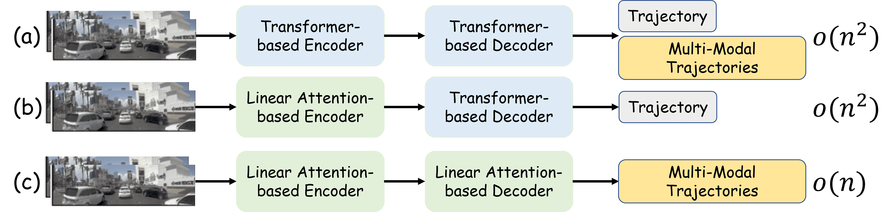
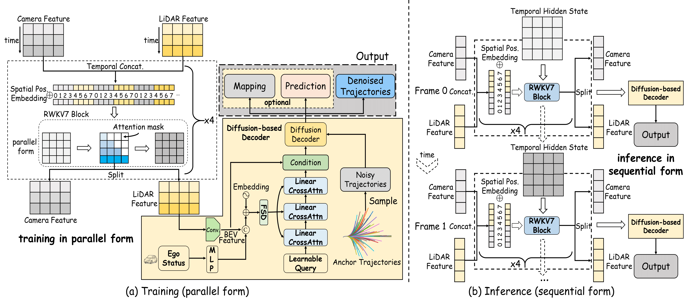
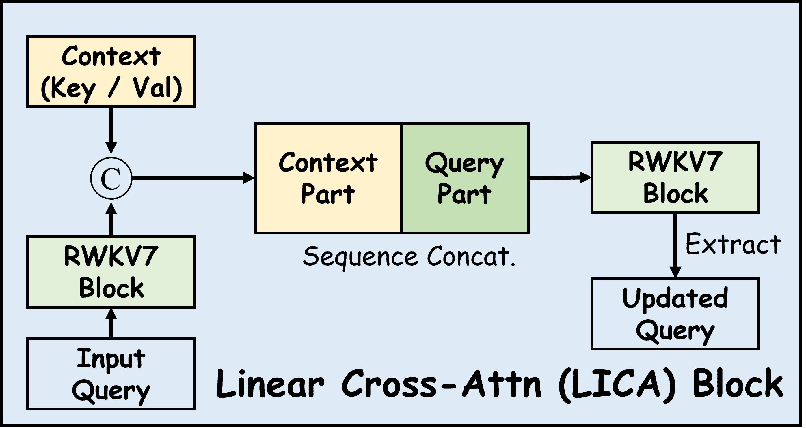
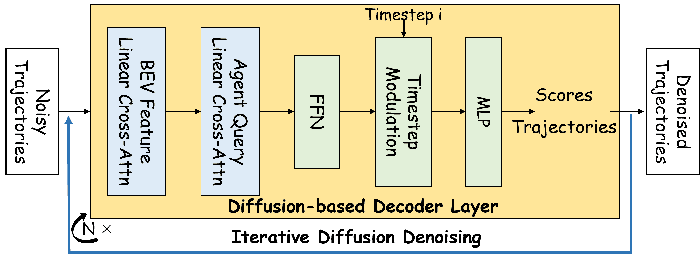
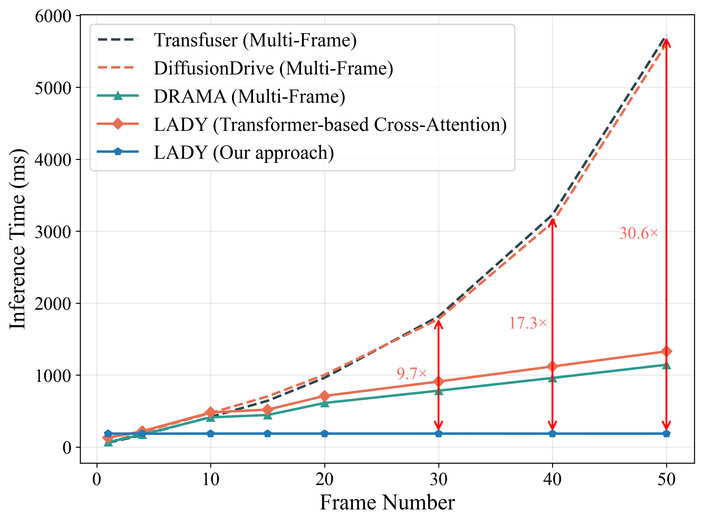
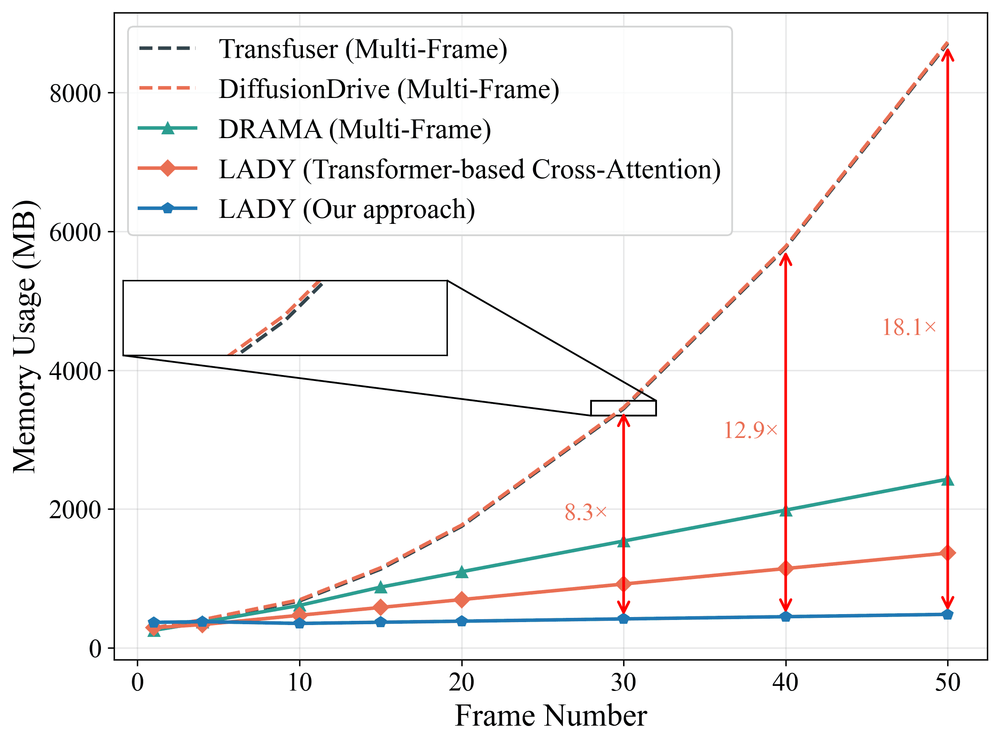
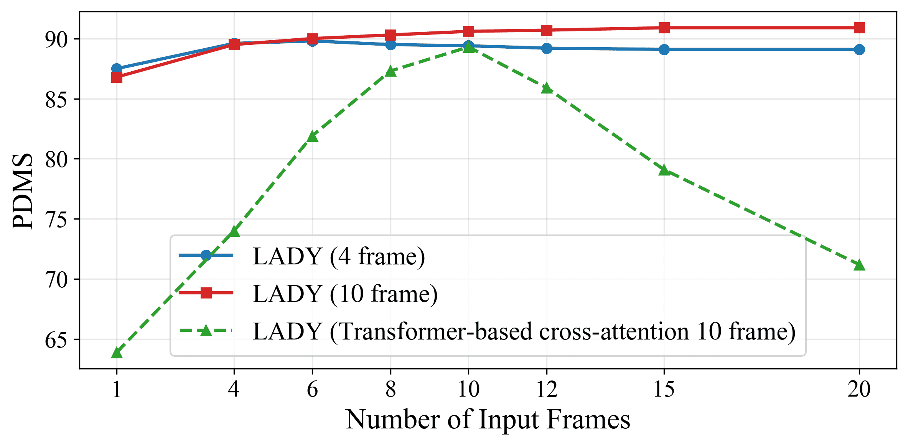
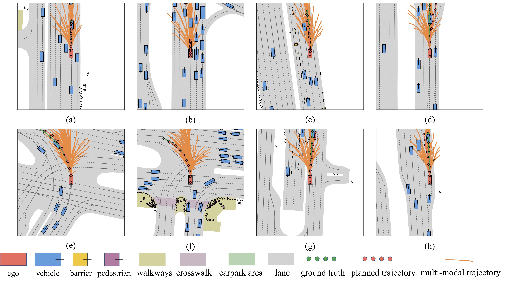
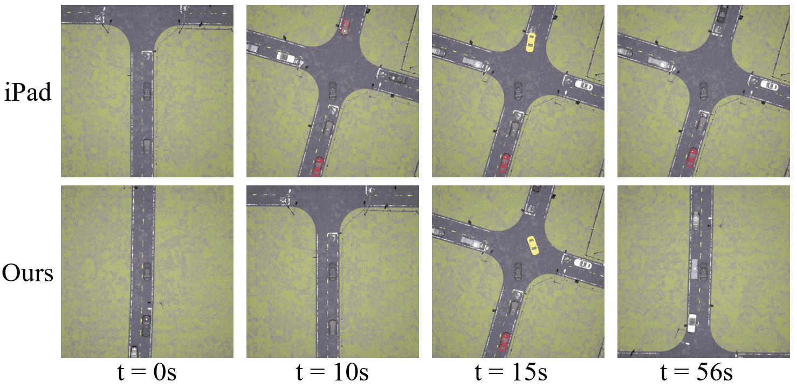
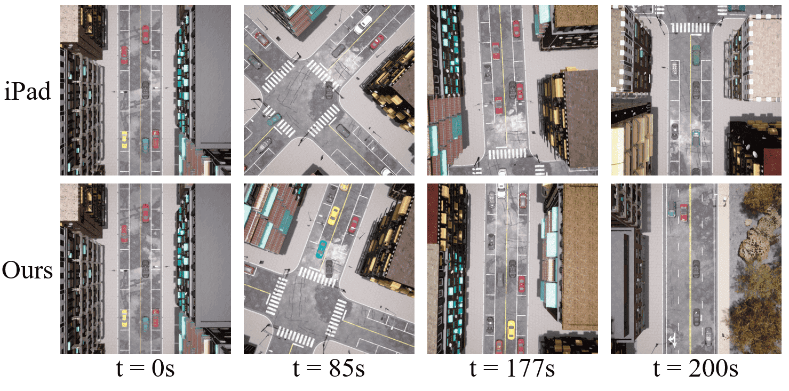

# LADY: <ins>L</ins>inear <ins>A</ins>ttention for Autonomous <ins>D</ins>riving Efficienc<ins>y</ins> without Transformers

**Jihao Huang, Xi Xia, Zhiyuan Li, Tianle Liu, Jingke Wang, Junbo Chen, Tengju Ye**

### [IEEE RA-L](https://doi.org/10.1109/LRA.2026.3673934) · [arXiv](https://arxiv.org/abs/2512.15038) · [PDF](https://arxiv.org/pdf/2512.15038) · [Model Weights](https://huggingface.co/Jihaoudeer/LADY) · [Method](#method-overview) · [Results](#paper-results) · [Installation](#installation) · [Training](#training) · [Evaluation](#evaluation) · [Citation](#citation)

This repository contains the **NAVSIM implementation of LADY**, built on the NAVSIM v1.1 devkit. LADY uses RWKV-7 linear attention to fuse multi-frame camera and LiDAR observations, introduces lightweight linear cross-attention (LICA) for context-conditioned decoding, and generates multi-modal trajectories with a truncated diffusion planner.

<p align="center">
  
</p>

**Fully linear-attention planning.** LADY uses linear attention for both sensor fusion and trajectory decoding, avoiding the Transformer cross-attention retained in hybrid architectures.

### Highlights

- **Multi-modal temporal fusion:** combine camera and LiDAR features across historical frames using RWKV-7.
- **Variable-length evaluation:** train with a fixed history length, then evaluate shorter or longer input histories using the same checkpoint, without retraining.
- **Linear cross-attention:** condition learnable queries and trajectory candidates on context without quadratic softmax attention maps.
- **Generative planning:** refine noisy trajectory anchors and select a trajectory using learned PDM scores.
- **Auxiliary supervision:** learn BEV semantics, surrounding-agent detections, collision-related agent states, and trajectory passability.

> **Release scope.** This repository provides the NAVSIM training and evaluation implementation. The paper also reports Bench2Drive and recurrent deployment experiments; those pipelines are not included here. The documented evaluation command processes a finite history window and does not maintain recurrent state across scenes. The paper's constant-cost recurrent inference results should not be interpreted as a guarantee for this batch evaluation path.

## Method overview

<p align="center">
  
</p>

**LADY framework.** Multi-frame camera and LiDAR features are fused with RWKV-7 and combined with the current ego status. LICA conditions trajectory generation on BEV features and agent queries. The diffusion decoder refines noisy anchors and predicts trajectory scores, with auxiliary mapping and prediction heads. The figure also illustrates the paper's recurrent inference design.

<details>
<summary><strong>Module details: linear cross-attention and diffusion decoder</strong></summary>

### Linear cross-attention (LICA)

<p align="center">
  
</p>

LICA first encodes the query sequence, then concatenates context tokens before the encoded queries. A second RWKV-7 block processes the combined sequence, and its query-token outputs provide context-conditioned representations without a quadratic attention map.

### Diffusion-based trajectory decoder

<p align="center">
  
</p>

Each decoder layer conditions noisy trajectory features on BEV features and agent queries using LICA, followed by a feed-forward network and timestep modulation. Prediction heads produce refined trajectories and scores for candidate selection.

</details>

## Paper results

Selected results reported in the [paper](https://arxiv.org/abs/2512.15038), **not measurements from this checkout**:

| Benchmark | Setting | Metric | Result |
| --- | --- | --- | --- |
| NAVSIM `navtest` | Multi-frame LADY | PDMS ↑ | 90.9 |
| Bench2Drive | LADY with long-term recurrent context | Driving Score ↑ | 65.12 |

The NAVSIM temporal-context ablation reports 90.6 PDMS with 10 input frames and 90.9 with 15 input frames, using a model trained with a fixed 10-frame history. **The same checkpoint supports different evaluation lengths without retraining.** The runtime camera/LiDAR sequence lengths and scene filter must agree with the requested evaluation length, not necessarily the training length. Training feature caches need not be rebuilt for evaluation. See [variable-length evaluation](docs/metrics.md#evaluating-lady-with-n-input-frames) and the paper for the complete protocols.

### Efficiency on edge hardware

<p align="center">
  
  
</p>

**Inference time (left) and memory usage (right)** on NVIDIA Jetson AGX Orin, as reported in the paper. These figures use the paper's recurrent inference protocol, not the finite-window evaluation command documented below. See the paper for measurement details and baseline settings.

<details>
<summary><strong>Temporal-context and LICA ablation</strong></summary>

<p align="center">
  
</p>

The paper compares models trained with different history lengths and a Transformer-based cross-attention variant. The horizontal axis varies the inference history length; each curve represents a distinct training configuration. See [the evaluation guide](docs/metrics.md#evaluating-lady-with-n-input-frames) for commands to vary the input length using a fixed checkpoint.

</details>

### Qualitative planning results

<p align="center">
  
</p>

**NAVSIM examples from the paper.** Orange curves show multi-modal trajectory candidates; red and green waypoints indicate the selected prediction and ground truth, respectively.

<details>
<summary><strong>Bench2Drive examples from the paper</strong></summary>

<p align="center">
  
</p>

**Intersection scenario.** The top row shows iPad and the bottom row shows LADY.

<p align="center">
  
</p>

**Long-horizon route scenario.** The top row shows iPad and the bottom row shows LADY. These are paper illustrations; the Bench2Drive training and deployment pipeline is not included in this NAVSIM release.

</details>

## Repository layout

```text
navsim/agents/lady/           LADY agent, model, backbone, features, and losses
navsim/agents/rwkv_block/     RWKV blocks and linear cross-attention implementation
navsim/agents/score_module/   Proposal scoring and auxiliary supervision
navsim/planning/script/      Hydra entrypoints and experiment configurations
scripts/                    Training, evaluation, caching, and submission examples
download/                   OpenScene and nuPlan map download scripts
docs/                       NAVSIM devkit reference documentation
figures/                     Paper figures used in this README
plan_anchors_100.npy         Default trajectory anchors
plan_anchors.npy             Alternative 20-anchor vocabulary
```

The Hydra agent name is `lady`, implemented by `LADYAgent` in [`lady_agent.py`](navsim/agents/lady/lady_agent.py). The LADY model is implemented in [`rwkv_fla_diffusion_model.py`](navsim/agents/lady/rwkv_fla_diffusion_model.py) and selected with `MODEL_TYPE=default`. Other retained models are not the default LADY configuration.

The LADY framework is not conceptually tied to RWKV-7; other linear sequence models can be integrated as backends. This release implements RWKV-7, so backend-specific classes and FLA operators retain their RWKV names. Renaming the package does not add other backends or change model weights. Existing checkpoints saved as `state_dict` retain the same parameter names; update Python imports and Hydra overrides to the paths above.

## Installation

### Requirements

- Linux x86_64, Conda, Git, a C/C++ compiler, and an NVIDIA GPU with a driver supporting CUDA 12.4.
- Python **3.10.22**, PyTorch **2.6.0+cu124**, torchvision **0.21.0+cu124**, and Triton **3.2.0**.
- [Flash Linear Attention](https://github.com/fla-org/flash-linear-attention) **0.4.1**, pinned to commit [`40263efd`](https://github.com/fla-org/flash-linear-attention/commit/40263efd9a09e02c53e2dc51924a0da2e12a2e59) from **2025-11-30**.
- OpenScene data and nuPlan maps; see [Data preparation](#data-preparation).

From the root of your clone:

```bash
conda env create -f environment.yml
conda activate navsim

# Install the matching GPU wheels first.
python -m pip install torch==2.6.0 torchvision==0.21.0 \
  --index-url https://download.pytorch.org/whl/cu124

# Install the validated package snapshot, including fixed FLA and nuPlan commits.
python -m pip install -r requirements-lock.txt
python -m pip install --no-deps --no-build-isolation -e .
python -m pip check
```

[`environment.yml`](environment.yml) creates the base environment only; the pip steps are required. [`requirements.txt`](requirements.txt) pins direct dependencies, while [`requirements-lock.txt`](requirements-lock.txt) records the validated direct and transitive package versions for this Linux/CUDA stack. The local package is installed with `--no-deps` to avoid resolving or fetching dependencies again. Do not upgrade FLA independently: this code uses its internal RWKV and Cache APIs.

Check CUDA and core imports before caching or training:

```bash
export NAVSIM_DEVKIT_ROOT="$(pwd)"
export MODEL_TYPE=default
python -c "import torch, diffusers, fla; from navsim.agents.lady.lady_agent import LADYAgent; assert torch.cuda.is_available(); print('torch:', torch.__version__, 'FLA:', fla.__version__, 'CUDA:', torch.version.cuda)"
```

This stack was validated on an RTX 4090 with NVIDIA driver 580.173.02. Checks covered RWKV forward/backward in FP16 and BF16 autocast, recurrent Cache updates, LICA variable-context inference, full-model synthetic 1/4-frame forward passes, and Hydra CLI composition. `lady.ckpt` also passed strict model-weight loading; dataset-based PDMS reproduction has not been performed in this environment.

See [the installation guide](docs/install.md) for the full version table, verification commands, and the **`cannot find -lcuda` Triton fix** needed on systems without an unversioned driver-library link. FLA's Python 3.11 recommendation and Python 3.10 `torch.compile` fallback messages are expected for this pinned stack; they do not disable Triton kernels.

## Data preparation

### 1. Download OpenScene and maps

Review the [nuPlan dataset license](https://motional-nuplan.s3-ap-northeast-1.amazonaws.com/LICENSE) before downloading. Run the scripts from inside `download/`:

```bash
cd download
bash download_maps.sh
bash download_trainval.sh
bash download_test.sh
cd ..
```

For a smaller initial setup, use `download_mini.sh`. `download_navtrain.sh` downloads the filtered training subset, including history data, instead of the full `trainval` sensor set. For multi-frame experiments, verify that the downloaded sensor blobs cover all requested history frames; the upstream reduced subset must not be assumed to cover arbitrary longer histories. See [dataset splits](docs/splits.md).

Arrange the extracted data as follows:

```text
dataset/
├── maps/
│   └── nuplan-maps-v1.0/
├── navsim_logs/
│   ├── trainval/
│   └── test/
└── sensor_blobs/
    ├── trainval/
    └── test/
```

### 2. Set paths and model selection

Run the following from the repository root, replacing the example data and experiment paths:

```bash
export NAVSIM_DEVKIT_ROOT="$(pwd)"
export NAVSIM_EXP_ROOT="/path/to/experiments"
export OPENSCENE_DATA_ROOT="/path/to/dataset"
export NUPLAN_MAPS_ROOT="$OPENSCENE_DATA_ROOT/maps"
export NUPLAN_MAP_VERSION="nuplan-maps-v1.0"
export MODEL_TYPE="default"
export USE_100_ANCHOR="true"
mkdir -p "$NAVSIM_EXP_ROOT"
```

Set these variables **before starting Python**: model selection and anchor-path configuration are evaluated at import time. `USE_100_ANCHOR=false` selects the 20-anchor vocabulary; training and evaluation must use the same vocabulary and architecture.

The RWKV shell wrappers preserve your exported paths. If unset, `NAVSIM_DEVKIT_ROOT` is inferred from the script location, `NAVSIM_EXP_ROOT` defaults to `<repo>/exp`, and `NUPLAN_MAPS_ROOT` defaults to `$OPENSCENE_DATA_ROOT/maps`. Set `OPENSCENE_DATA_ROOT` before running them. In the submission wrapper, fill in the blank `TEAM_NAME`, `AUTHORS`, `EMAIL`, and `INSTITUTION` fields and export `COUNTRY` before use.

The anchor-clustering tools use `FEATURE_CACHE` (default: `$NAVSIM_EXP_ROOT/training_cache`), `NAVSIM_VIS_ROOT` (default: `$NAVSIM_EXP_ROOT/vis`), and `TRAJ_DUMP_PATH` (default: `$NAVSIM_VIS_ROOT/traj_dump.pkl`). Without `NAVSIM_EXP_ROOT`, they also use `<repo>/exp`. Generated anchor files are named `plan_vocab_<K>_kmeans.npy` without personal identifiers.

### 3. Build metric caches

Metric caches provide the rule-based supervision used to train the trajectory scorer and the reference data required for evaluation. They are distinct from the feature/target caches created in the next step.

```bash
# Training/validation proposal supervision.
python "$NAVSIM_DEVKIT_ROOT/navsim/planning/script/run_metric_caching.py" \
  train_test_split=navtrain \
  train_test_split.scene_filter.num_history_frames=10 \
  cache.cache_path="$NAVSIM_EXP_ROOT/metric_cache_training_new"

# NAVSIM navtest evaluation.
python "$NAVSIM_DEVKIT_ROOT/navsim/planning/script/run_metric_caching.py" \
  train_test_split=navtest \
  train_test_split.scene_filter.num_history_frames=10 \
  cache.cache_path="$NAVSIM_EXP_ROOT/metric_cache"
```

**Current path requirement:** `LADYAgent.__init__` loads `$NAVSIM_EXP_ROOT/metric_cache_training_new` unconditionally, including during evaluation. Keep this cache and its metadata available for both stages. The evaluation command separately reads its `metric_cache_path`.

### 4. Build feature and target caches

Use `lady_cache` to build caches with LADY's own feature/target builders, without instantiating the model or its scorer. The cache identifiers remain `transfuser_feature` and `transfuser_target` for compatibility with existing LADY caches.

Set the scene history and both sensor sequence lengths to the same training input length (ten frames below):

```bash
export FEATURE_CACHE="$NAVSIM_EXP_ROOT/training_cache_lady_10"

python "$NAVSIM_DEVKIT_ROOT/navsim/planning/script/run_dataset_caching.py" \
  agent=lady_cache \
  +agent.config.cam_seq_len=10 \
  +agent.config.lidar_seq_len=10 \
  train_test_split=navtrain \
  train_test_split.scene_filter.num_history_frames=10 \
  cache_path="$FEATURE_CACHE" \
  enable_padding=false \
  experiment_name=lady_cache_10
```

The current feature builder already left-pads camera and LiDAR tensors to the configured length and saves `valid_frame_len`. It saves only the **current** ego status, with shape `[8]` per sample. Keep `enable_padding=false` for cache-only training: the dataset-level padding branch expects a history of ego states and is incompatible with this current-status representation. Disabling that branch does **not** disable the padding performed by the feature builder.

Cache files are stored as:

```text
<feature_cache>/<log_name>/<token>/transfuser_feature.gz
<feature_cache>/<log_name>/<token>/transfuser_target.gz
```

## Training

After both caches are ready, train the default LADY model:

```bash
python "$NAVSIM_DEVKIT_ROOT/navsim/planning/script/run_training.py" \
  agent=lady \
  train_test_split=navtrain \
  train_test_split.scene_filter.num_history_frames=10 \
  cache_path="$FEATURE_CACHE" \
  use_cache_without_dataset=true \
  enable_padding=false \
  dataloader.params.batch_size=4 \
  dataloader.params.num_workers=4 \
  trainer.params.strategy=ddp_find_unused_parameters_true \
  trainer.params.max_epochs=100 \
  experiment_name=lady_navtrain
```

`dataloader.params.batch_size` is per process; select the GPU count and batch size for your hardware. For an initial smoke test, add `trainer.params.fast_dev_run=true`. Outputs are written under `$NAVSIM_EXP_ROOT/<experiment_name>/<timestamp>/`.

Important settings in [`rwkv_config.py`](navsim/agents/lady/rwkv_config.py):

| Setting | Default |
| --- | --- |
| Camera / LiDAR input length | 10 / 10; configurable independently of checkpoint training length at evaluation |
| Future trajectory | 8 poses over 4 seconds |
| Camera and LiDAR encoders | ResNet-34 |
| Decoder feature dimension | 256 |
| Diffusion decoder layers | 2 |
| Trajectory anchors | 100 |
| Inference denoising steps | 2, defined in the model |

## Evaluation

Pretrained model weights are available on [Hugging Face: Jihaoudeer/LADY](https://huggingface.co/Jihaoudeer/LADY). Download the checkpoint and set `CHECKPOINT` to its local path. Use the default architecture and matching anchor vocabulary.

**Training and evaluation lengths can differ.** For example, train on 10 frames, then evaluate the same checkpoint on 15 frames by setting `EVAL_FRAMES=15`. Use 1, 4, 10, 20, or another positive length as required; no retraining is needed.

```bash
export CHECKPOINT="/path/to/lady.ckpt"
export EVAL_FRAMES=15

python "$NAVSIM_DEVKIT_ROOT/navsim/planning/script/run_pdm_score_rwkv.py" \
  agent=lady \
  agent.checkpoint_path="$CHECKPOINT" \
  +agent.config.cam_seq_len="$EVAL_FRAMES" \
  +agent.config.lidar_seq_len="$EVAL_FRAMES" \
  train_test_split=navtest \
  train_test_split.scene_filter.num_history_frames="$EVAL_FRAMES" \
  metric_cache_path="$NAVSIM_EXP_ROOT/metric_cache" \
  worker=sequential \
  enable_padding=false \
  experiment_name="lady_navtest_${EVAL_FRAMES}frames"
```

`worker=sequential` is a simple single-process starting point; GPU inference is still required. Use the distributed worker configuration after validating GPU allocation and environment propagation. Evaluation writes a per-scenario CSV and an average row to the experiment directory. Inspect failed-scenario counts as well as average PDMS.

Only the runtime input configuration changes when selecting another `EVAL_FRAMES`; keep the checkpoint and architecture unchanged. Evaluation reads raw sensor data, so the training feature cache can remain at its original length. The same metric cache can be reused for the same scenarios and scoring setup. See [the evaluation guide](docs/metrics.md#evaluating-lady-with-n-input-frames) for a multi-length sweep and a code-level explanation.

Keep `agent.config.use_gt_eval=false` for standard evaluation. Enabling it selects candidates with the ground-truth evaluator, which is an **oracle / best-of-N analysis**, not the learned-scoring result. That analysis additionally expects `$NAVSIM_EXP_ROOT/metric_cache_test`.

For submission format and scoring, see [the NAVSIM submission reference](docs/submission.md). Update checkpoint paths and team metadata before using [`run_rwkv_create_submission_pickle.sh`](scripts/submission/run_rwkv_create_submission_pickle.sh).

## Practical notes

- **History configuration:** within each run, match the scene filter, `cam_seq_len`, and `lidar_seq_len` to that run's input length. The evaluation length can differ from the training length with the same checkpoint. Rebuild training feature caches only when changing the cached training representation, not when changing evaluation length. `model_seq_len` is a legacy field not read by the current default model.
- **Cache indices:** `CacheOnlyDataset` saves sample indices in `<feature_cache>/debug/train_cache_paths.pkl` and `val_cache_paths.pkl`. Remove those specific index files after changing cached samples or log lists so they can be rebuilt.
- **Distributed execution:** configure the same paths, dependencies, and environment variables on every Ray node/worker. Do not assume a driver-side environment change is propagated to existing remote workers.
- **Jetson:** use PyTorch/torchvision wheels compatible with the installed JetPack/CUDA stack. [Jetson AI Lab](https://pypi.jetson-ai-lab.dev/jp6/cu126) provides wheels for a specific JetPack 6 / CUDA 12.6 stack; it is not a universal installation source. Match FLA and Triton support as well.
- **Timing:** CUDA execution is asynchronous. Use warm-up iterations and explicit CUDA synchronization around timed regions. `CUDA_LAUNCH_BLOCKING=1` can help debugging, but it changes execution behavior and should not be used as a substitute for a controlled performance benchmark.
- **Reproduction status:** the pinned environment passed GPU operator tests, synthetic model forward passes, and CLI configuration checks. These checks do not replace end-to-end training or PDMS verification on the target GPU and dataset.

## NAVSIM reference documentation

The following documents are retained from the upstream devkit. Use the LADY-specific instructions above for this repository's model and cache workflow.

- [Download and installation reference](docs/install.md)
- [Agent interface](docs/agents.md)
- [Data format and multi-frame caching](docs/cache.md)
- [Dataset splits](docs/splits.md)
- [PDM Score and evaluation with different history lengths](docs/metrics.md)
- [Submission format](docs/submission.md)

## Acknowledgements

This implementation builds on [NAVSIM](https://github.com/autonomousvision/navsim), [nuPlan](https://github.com/motional/nuplan-devkit), [OpenScene](https://github.com/OpenDriveLab/OpenScene), [TransFuser](https://github.com/autonomousvision/transfuser), [DiffusionDrive](https://github.com/hustvl/DiffusionDrive), [iPad](https://github.com/Kguo-cs/iPad) by Ke Guo et al., [RWKV](https://github.com/BlinkDL/RWKV-LM), and [Flash Linear Attention](https://github.com/fla-org/flash-linear-attention). We thank the authors and maintainers for their open-source contributions.

## Citation

If you find LADY useful in your research, please cite:

```bibtex
@article{huang2026lady,
  title   = {{LADY}: Linear Attention for Autonomous Driving Efficiency Without Transformers},
  author  = {Huang, Jihao and Xia, Xi and Li, Zhiyuan and Liu, Tianle and Wang, Jingke and Chen, Junbo and Ye, Tengju},
  journal = {IEEE Robotics and Automation Letters},
  year    = {2026},
  volume  = {11},
  number  = {5},
  pages   = {5598--5605},
  month   = may,
  doi     = {10.1109/LRA.2026.3673934},
  url     = {https://doi.org/10.1109/LRA.2026.3673934}
}
```

Please also acknowledge the NAVSIM benchmark when using its data and evaluation framework:

```bibtex
@article{dauner2024navsim,
  title   = {NAVSIM: Data-Driven Non-Reactive Autonomous Vehicle Simulation and Benchmarking},
  author  = {Dauner, Daniel and Hallgarten, Marcel and Li, Tianyu and Weng, Xinshuo and Huang, Zhiyu and Yang, Zetong and Li, Hongyang and Gilitschenski, Igor and Ivanovic, Boris and Pavone, Marco and Geiger, Andreas and Chitta, Kashyap},
  journal = {arXiv preprint arXiv:2406.15349},
  year    = {2024}
}
```

## License

This repository retains the [Apache License 2.0](LICENSE) from NAVSIM unless otherwise noted. Third-party components remain subject to their respective licenses. The nuPlan and OpenScene datasets have separate terms and are not distributed under the code license.
